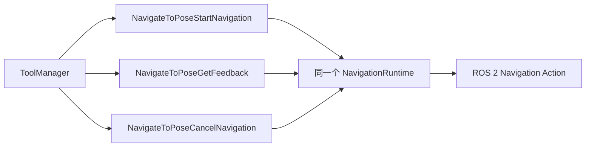

# Scout Mini Agent 规划

日期：2026-10-23。本文分为输入输出约束、工具定义与管理、SessionManager 会话管理、用户交互管理、后续规划五部分。本次只完善规划；VLNAgent 主流程待相关组件完成后再设计。

高层流程改为 Agent 驱动，通过 Responses API 的 Function Calling 调用小车工具。本文作为新方案的输入输出基线；旧的自定义 navigator、模型交互 BT 节点规划不再作为新架构的设计依据。

2026-10-24 数据归属更新：各组件只保存配置、当前状态及尚待执行/交付的数据。
所有已结束输入、输出、调用历史和历史去重由高层 Agent 管理；本轮不实现其主流程。
ToolManager 完成即移除活动记录，交互组件成功交付后不再接受旧完成事件的重复投递。

## 一、输入输出约束

### 1. 总体约定

- 用户指令和小车主动消息采用标准输入 JSON；函数执行结果独立采用 API 原生的 `function_call_output`。
- 普通业务输入来源分为 `user` 和 `robot`；系统规则与工具定义分别使用 API 的系统消息和 `tools`。
- 业务输出只消费 API 原生的 `message` 和 `function_call`，不另建动作输出 JSON 外壳。
- 函数定义设置 `async: true`，允许各调用结果独立回传；设置 `parallel_tool_calls: true` 允许同一响应包含多个函数，本地工具执行由 ToolManager 队列按阻塞策略调度。
- 报错、调试、状态等主动消息由其他 ROS 节点或手动上报，交给 EventManager 自主管理。
- ToolManager 负责函数定义、插件、共享资源、工具执行队列和逐调用 future；与 UserInteractionManager、SessionManager、EventManager 解耦。
- 模型请求的拼装、两份输入缓冲和最高频率调度由 SessionManager 管理；VLNAgent 主流程和 EventManager 的内部设计暂不展开。
- UserInteractionManager 统一负责用户输入输出，加载交互插件并通过 weak_ptr 查询其他组件；exchange() 直接合并插件返回的原生输入数组，并按各插件配置传递共享的增量汇总 JSON。它不接收机器人主动消息，不消费 Agent 的完整 response 或工具 future。

`source` 和 `time_stamp` 是标准业务输入仅有的两个公共必填字段；`pose` 等都是可选业务字段，不是 Responses API 的顶层参数。模型、连接、上下文与缓存配置统一放入全局 YAML，由 SessionManager 读取。

对象所有权统一优先使用智能指针：独占的 Impl、传输对象和插件加载器用 unique_ptr；共享资源、插件实例和跨插件共享的只读数据用 shared_ptr；查询其他组件、保存外部 ROS 节点或回调中反向引用所属对象时用 weak_ptr，避免引用环。一次操作先 lock() 取得局部 shared_ptr 保持对象存活；JSON 值、标量和只在函数调用期间使用的 const 引用保持值/引用语义，不为它们单独分配指针。

### 2. 标准输入 JSON

#### 2.1 字段

| 字段 | 约束 | 含义 |
| --- | --- | --- |
| `source` | 必填，`"user"` 或 `"robot"` | 输入来自用户还是小车 |
| `time_stamp` | 必填，固定三位毫秒的 UTC 字符串 | 指令接收或事件发生的时刻，格式为 `YYYY-MM-DDTHH:mm:ss.SSSZ`，例如 `2026-10-21T06:00:00.000Z` |
| `pose` | 可选，位姿对象或 `null` | 有相关位姿时由输入来源提供；用户输入无需携带或自动补齐 |
| `instruction` | 可选，字符串 | 用户文字指令；具体业务按需要携带 |
| `event` | 可选，字符串 | `status`：状态/观测；`error`：报错；`debug`：调试信息 |
| `data` | 可选，对象 | 具体状态、错误或调试数据；业务扩展可放在这里 |
| `images` | 有图片时填写，数组 | 每张图片的 `camera`、`time_stamp`；与后续原生图片项一一按顺序对应 |

公共格式只要求 source 和 time_stamp；其余字段按内容需要提供，不适用时省略。时间戳记录实际事件/采样时刻，排队发送时不改成发送时刻。用户渠道插件提供已经包含标准业务 JSON 的原生 API 输入项，UserInteractionManager 只合并，不补位姿、不重写字段。

#### 2.2 位姿

首版使用二维位姿：`{"frame_id":"map","x":1.2,"y":2.3,"yaw":0.5}`。

`frame_id` 明确坐标系，`x/y` 单位为米，`yaw` 单位为弧度。没有相关位姿时可直接省略 pose；明确表达未知位姿时也可填 null，不用零坐标代替未知值。有采样时间时可附加 pose.time_stamp，采用第 2.5 节同一 UTC 毫秒格式。

#### 2.3 用户指令示例

```json
{
  "source": "user",
  "time_stamp": "2026-10-21T06:00:00.000Z",
  "instruction": "前往走廊尽头，途中检查是否存在障碍物。"
}
```

#### 2.4 小车主动报错示例

```json
{
  "source": "robot",
  "time_stamp": "2026-10-21T06:01:00.000Z",
  "event": "error",
  "data": {
    "code": "LOCALIZATION_LOST",
    "message": "暂时无法获得有效定位。"
  }
}
```

状态与调试消息使用同样外壳，将 `event` 设为 `status` 或 `debug`，在 `data` 中放具体内容。这些消息由其他 ROS 节点或手动上报，交给 EventManager 接收和管理；其内部管理方式及输入队列衔接暂不展开。

#### 2.5 全部组件统一时间戳

本项目各组件自行定义的输入、输出、工具结果、图片采样元数据和交互汇总包中的绝对时间，统一使用 UTC、固定三位毫秒、末尾 Z 的字符串：

```text
2026-10-21T06:00:00.000Z
YYYY-MM-DDTHH:mm:ss.SSSZ
```

字段统一使用 time_stamp 或含义明确的 *_time_stamp，不再用浮点 Unix 秒、毫秒整数或 {"sec":...,"nanosec":...} 对象表示同一类项目时间戳。时间字符串始终保留三位毫秒，即使为 .000；采样时刻、用户提交时刻和结果生成时刻分别记录，不在转发时覆盖。

在 include/vln_agent/utils/time.hpp 和 src/utils/time.cpp 提供共享格式化函数 formatUtcTime(system_clock::time_point) 与 utcNow()，各组件、工具插件和用户交互端复用。绝对时间用 system_clock；SessionManager 限频、超时和工具耗时继续用 steady_clock。wait_ms、run_ms、navigation_time_sec、estimated_time_remaining_sec 等时长保持数值，不转换成日期。

- 工具结果的 payload 至少包含 ok/time_stamp；工具拒绝和异常结果也遵循此格式。
- CaptureImage 将原有 stamp.sec/nanosec 的 JSON 输出改为 image_time_stamp 字符串，另以 time_stamp 表示结果生成时间。只有能对应真实 UTC 的 ROS 采样时间才转换；无法映射时省略采样时间，不把仿真时钟当成墙上时钟。
- 导航反馈若携带反馈采样时刻，使用 feedback_time_stamp；其他插件有采样、开始、结束等绝对时刻时采用同一格式。
- 交互汇总包在生成新的批次时填写 time_stamp；空轮询不因“当前时间变化”单独制造更新。相同批次重试保持原时间。
- Responses 等外部协议固有字段在底层收发时遵守其协议，完整原始 response 仍原样交给 Agent；若其数值时间需要进入用户展示数据，在展示副本中转成上述字符串字段，不改写发送给服务端的原生字段。项目新增的业务时间一律使用上述格式。

### 3. 映射到 Responses 的 input

#### 3.1 用户指令与小车主动事件

两者都放入 `role: "user"` 的消息，在 `input_text.text` 中保存完整的标准 JSON 字符串。API 的 `role` 表示消息角色，业务上的真实来源由 `source` 区分；小车状态不使用 `system` 角色。[官方消息与工具结果映射](https://developers.openai.com/api/docs/guides/migrate-to-responses)

以下只展示请求的 `input` 部分；实际请求同时携带工具列表和模型等公共配置：

```json
{
  "input": [
    {
      "role": "user",
      "content": [
        {
          "type": "input_text",
          "text": "{\"source\":\"user\",\"time_stamp\":\"2026-10-21T06:00:00.000Z\",\"instruction\":\"前往走廊尽头，途中检查是否存在障碍物。\"}"
        }
      ]
    }
  ]
}
```

`input` 的元素是 API 消息或工具结果项，不能直接放任意业务对象或裸 JSON 字符串。图片以同一消息的后续 `input_image` 内容项传入，`images` 仅描述图片元数据。

#### 3.2 工具执行结果

工具执行结果使用 `function_call_output`，与第 2 节的用户/小车标准输入分别定义。`output` 使用内容数组：第一项 `input_text` 只包含本函数结果对象的 JSON 字符串，后面可追加原生图片项；不套用 `source/time_stamp/pose/event/data` 标准输入外壳。`call_id` 复制本次模型工具调用的值。[官方内容类型定义](https://developers.openai.com/api/reference/python/resources/responses)

下例为 `navigate_to_pose_get_feedback` 的回传片段，图片数据是占位符：

```json
{
  "input": [
    {
      "type": "function_call_output",
      "call_id": "call_feedback_002",
      "output": [
        {
          "type": "input_text",
          "text": "{\"ok\":true,\"task_id\":\"nav_001\",\"status\":\"running\",\"distance_remaining_m\":12.5,\"time_stamp\":\"2026-10-21T06:00:00.000Z\"}"
        },
        {
          "type": "input_image",
          "image_url": "data:image/jpeg;base64,<图片Base64数据>",
          "detail": "auto"
        }
      ]
    }
  ]
}
```

工具结果约定：

- 结果对象至少包含布尔值 ok 和结果生成时刻 time_stamp，表示本次函数操作是否成功以及生成结果的时间；失败时增加 code 和 message。time_stamp 统一为第 2.5 节的 UTC 毫秒字符串。
- 插件复用通用时间工具生成时间戳。ToolManager 在封装结果时为缺少 time_stamp 的成功、拒绝、异常等路径统一补齐，已有采样时间保持原值；不添加普通业务输入的 source 外壳。
- 其他字段由具体工具定义。导航反馈可直接返回 `task_id/status/distance_remaining_m`，图片使用原生 `input_image` 项。
- 持续动作的 `status` 可为 `running / succeeded / failed / canceling / canceled / rejected`，具体枚举由工具固定。
- `ok: true` 表示本次启动、查询或取消请求处理成功，不保证物理动作已经完成；例如查询成功仍可得到 `status: "failed"`。
- ToolManager 只封装调用结果的 API 外层和 `call_id`，不补齐普通业务输入字段，也不把同一个结果重复转换成小车标准输入。

一次请求可以只携带工具执行结果，无需额外制造标准输入消息。用户指令、小车主动消息和工具结果在 `input` 中作为独立项出现，各组件提供已经包装好的 API 输入项，SessionManager 按添加顺序拼装和发送。

没有对应函数调用的主动报错、调试或状态消息走 EventManager，使用第 3.1 节的普通消息形式。系统提示词和已有历史项保持 API 原生结构。

### 4. 模型输出

业务层直接按 `response.output[]` 中的 `type` 分发：

| 类型 | 程序处理方式 |
| --- | --- |
| `message` | 提取 `content[]` 中的 `output_text.text`，供用户观看；若出现 `refusal`，展示其说明 |
| `function_call` | 读取 `name`、`call_id`，将 `arguments` 字符串解析为 JSON，调用对应本地工具，再回传结果 |

输出片段示例：

```json
{
  "output": [
    {
      "id": "msg_001",
      "type": "message",
      "role": "assistant",
      "status": "completed",
      "content": [
        {
          "type": "output_text",
          "text": "我将开始前往目标位置。",
          "annotations": []
        }
      ]
    },
    {
      "id": "fc_001",
      "type": "function_call",
      "call_id": "call_start_001",
      "name": "navigate_to_pose_start_navigation",
      "async": true,
      "arguments": "{\"frame_id\":\"map\",\"x\":10,\"y\":3,\"yaw\":0}",
      "status": "completed"
    }
  ]
}
```

`message` 使用自然语言文本，保持 `text.format.type: "text"`；工具参数由各工具的 Schema 约束。程序只根据 `function_call` 执行动作，不从展示文本中提取控制指令。[官方 Function Calling 格式](https://developers.openai.com/api/docs/guides/function-calling)

同一次响应可以只有消息、只有工具调用，或同时包含二者。原始输出还可能包含 `reasoning`、`compaction` 等上下文项，由会话层按 API 要求保留；它们不进入业务分发，也不因“业务输出只有两类”而被丢弃。

`response.status: "completed"` 表示本轮模型生成结束；`function_call.status: "completed"` 表示调用内容生成完毕。导航完成与否以本地动作状态和工具结果对象中的 `status` 为准。

## 二、工具定义、载入与管理

### 5. 工具 JSON 定义与参数约束

共享同一资源的一组函数共用一个 `tool.json`，文件内容统一为原生 function 定义数组；独立工具也使用只有一个元素的数组。每个 function 仍对应一个独立 ROS 2 插件类。类名将 API 工具名按下划线分词，各词首字母大写后拼接（PascalCase）；例如 `navigate_to_pose_start_navigation` 对应 `NavigateToPoseStartNavigation`。配置和插件导出使用同一完整名称。

| ROS 2 插件类 | API 工具名 | 参数与返回约定 |
| --- | --- | --- |
| `NavigateToPoseStartNavigation` | `navigate_to_pose_start_navigation` | 参数为目标位姿；目标接受后返回 `task_id` 与 `status: "running"`，不等待抵达 |
| `NavigateToPoseGetFeedback` | `navigate_to_pose_get_feedback` | 参数为 `task_id`；返回该任务最新状态及可选图片 |
| `NavigateToPoseCancelNavigation` | `navigate_to_pose_cancel_navigation` | 参数为 `task_id`；取消处理中返回 `canceling`，收到最终结果后才标记 `canceled` |

`plugins/tools/navigate_to_pose/tool.json` 示例：

```json
[
  {
    "type": "function",
    "name": "navigate_to_pose_start_navigation",
    "description": "启动导航，目标被接受后返回任务 ID 和 running 状态；不会等待到达。",
    "async": true,
    "strict": true,
    "parameters": {
      "type": "object",
      "properties": {
        "frame_id": {
          "type": "string",
          "description": "目标所在坐标系，例如 map。"
        },
        "x": {
          "type": "number",
          "description": "目标 x 坐标，单位米。"
        },
        "y": {
          "type": "number",
          "description": "目标 y 坐标，单位米。"
        },
        "yaw": {
          "type": "number",
          "description": "目标朝向，单位弧度。"
        }
      },
      "required": [
        "frame_id",
        "x",
        "y",
        "yaw"
      ],
      "additionalProperties": false
    }
  },
  {
    "type": "function",
    "name": "navigate_to_pose_get_feedback",
    "description": "获取指定导航任务的最新反馈，可包含图片。",
    "async": true,
    "strict": true,
    "parameters": {
      "type": "object",
      "properties": {
        "task_id": {
          "type": "string",
          "description": "启动导航返回的本地任务 ID。"
        }
      },
      "required": [
        "task_id"
      ],
      "additionalProperties": false
    }
  },
  {
    "type": "function",
    "name": "navigate_to_pose_cancel_navigation",
    "description": "请求取消指定导航任务，返回取消请求的处理结果。",
    "async": true,
    "strict": true,
    "parameters": {
      "type": "object",
      "properties": {
        "task_id": {
          "type": "string",
          "description": "启动导航返回的本地任务 ID。"
        }
      },
      "required": [
        "task_id"
      ],
      "additionalProperties": false
    }
  }
]
```

`async: true` 允许对应函数结果在后续请求中独立返回；`strict` 约束参数。它们与本地 YAML 的 `blocking` 分别控制 API 交互和本地队列调度，不相互替代。[官方异步工具调用说明](https://developers.openai.com/api/docs/guides/async-tool-calling)

工具参数仅描述执行该函数需要的数据，工具返回值使用第 3.2 节的独立结果对象。导航的 `task_id` 由共享资源管理，在导航工具的参数和结果之间传递；ToolManager 不为所有工具定义通用任务字段。共享 JSON 和全局配置的关联见第 8 节。

### 6. 持续动作的关联规则

1. `NavigationRuntime` 创建并维护导航任务记录，以 `task_id` 为内部标志；`start_navigation` 返回该标志及启动结果，本次函数调用结束后小车继续导航。
2. 模型后续通过导航工具的 `task_id` 参数调用 `get_feedback` 或 `cancel_navigation`。每次函数调用有新的 `call_id`，结果匹配各自的调用。
3. ROS 回调只更新唯一当前任务的反馈和终态；终态作为待交付结果保留到首次读取，
随后释放。未读取终态时启动新任务返回 NAVIGATION_RESULT_PENDING，历史由 Agent 保存。
4. 已完成的启动或查询调用不因导航状态变化而重复返回结果。主动状态、报错或调试消息由 EventManager 独立管理，不复用已结束调用的 `call_id`。
5. `call_id` 用于 API 工具调用关联；`response_id` 由 SessionManager 管理模型上下文。ToolManager 不管理模型会话状态。

本节只约定持续动作与函数调用的关系，不设计事件如何触发模型请求。

### 7. 工具插件与职责

一个模型 `function` 对应一个 `pluginlib` 插件类，插件统一继承 `ToolPluginBase`。同一个共享库可以导出多个插件，不要求每个函数单独建一个 ROS 节点或功能包。

| 组件 | 职责 |
| --- | --- |
| 函数插件 | 实现一个具体函数，读取参数并调用 ROS 或共享业务对象 |
| `ToolPluginBase` | 固定初始化、执行、关闭接口 |
| `SharedResources` | 按名称和类型保存共享业务对象，作用域为本次 ToolManager 实例 |
| `NavigationRuntime` | 保存导航 Action 客户端、任务、GoalHandle、反馈和最终状态 |
| `ToolManager` | 加载 JSON 和插件、组织 `tools`、调度本地执行、返回逐调用 future |
| `SessionManager` | 拼装请求、内部限频调度和管理上下文，调用独立 WebSocket 传输类 |
| `EventManager` | 独立接收、管理其他 ROS 节点或手动上报的状态、报错和调试消息 |
| `UserInteractionManager` | 汇集用户渠道输入，查询组件并向各交互插件发送独立配置的汇总 JSON |
| `UserInterfaceBase` | 用户交互插件的共同基类，适配 ROS 话题、WebSocket 等用户渠道 |



ToolManager 只操作本地插件、共享资源、工具执行队列、future 和 JSON 数据。它不持有或调用 UserInteractionManager、SessionManager、EventManager，也不管理普通业务输入或主动事件。

ToolManager 复用注入的 ROS 节点，不要求注册为 `rclcpp_components` 组件；插件也不访问模型会话或 VLNAgent 对象。SessionManager 的接口和调度在第三部分规划；用户输入输出由第四部分的 UserInteractionManager 统一管理，EventManager 的内部设计及 VLNAgent 主流程仍暂不展开。

#### 7.1 固定插件接口

```cpp
class ToolPluginBase
{
public:
  virtual ~ToolPluginBase() = default;
  virtual void initialize(const ToolContext & context,
                          const Json & settings) = 0;
  virtual ToolResult execute(const Json & arguments) = 0;
  virtual void shutdown() noexcept = 0;
};
```

每个插件都实现这三个方法。`pluginlib` 使用无参构造创建对象，再通过 `initialize()` 注入依赖；`execute()` 可调用多次，`shutdown()` 负责唤醒自身等待、释放自身资源，要求可重复调用。[ROS 2 Humble 官方插件教程源码](https://github.com/ros2/ros2_documentation/blob/humble/source/Tutorials/Beginner-Client-Libraries/Pluginlib.rst)

`ToolContext` 只提供工具执行所需的通用依赖：ROS 节点的 weak_ptr、同一份 shared_ptr<SharedResources>、`group_id/group_settings` 和共享关闭标志。它不提供输入快照、机器人事件投递或会话传输接口；需要观测数据的插件通过自身 ROS 接口或组内共享资源获取。

`ToolResult` 只保存本函数的结果对象 `payload` 和可选原生图片内容项。`payload` 至少包含 ok 与 time_stamp，遵循第 3.2 节的 status/code/message 约定；结果时刻和采样时刻均使用第 2.5 节统一格式，其余字段由插件定义。Manager 将 `payload` 序列化为 `input_text.text`，与图片一起封装到单个 `function_call_output`，并填入对应 `call_id`。插件不重复编写 API 外壳，也不在返回值中硬编码函数定义。

#### 7.2 有状态工具类与函数插件的适配

保留普通业务类 `NavigationRuntime`，启动、查询和取消插件只是三个适配入口：

```cpp
// 三个插件都在 initialize() 中取得相同资源。
auto node = context.node.lock();
navigation_ = context.resources->getOrCreate<NavigationRuntime>(
  context.group_id + "/navigation", [&, node] {
    return std::make_shared<NavigationRuntime>(
      node, context.group_settings);
  });

// 各插件 execute() 分别转发到共享对象的对应方法。
return navigation_->start_navigation(arguments);  // Start 插件
return navigation_->get_feedback(arguments);      // Feedback 插件
return navigation_->cancel_navigation(arguments); // Cancel 插件
```

上面的三个 `return` 表示三个独立插件的方法，不是同一个函数体。`getOrCreate` 只在首次访问时创建对象；相同资源名但类型不一致时报告配置错误。创建工厂立即执行且不被保存。

- 共享对象按 Manager 实例隔离，不使用全局静态单例，也不让三个插件各自创建导航客户端和任务表。
- 共享类与相关函数插件放在同一个组目录，可一起编入该组的共享库；Manager 只认识通用资源接口，不包含导航专用头文件或函数名分支。
- 单次 `execute()` 返回不销毁资源。导航通过 ROS 回调继续运行，反馈按 `task_id` 更新到同一任务记录。
- 首版导航资源只允许一个活动导航任务；再次启动返回 `ok: false`、`code: "NAVIGATION_BUSY"`。查询、取消可与导航运行同时进行。
- 反馈和终态记录保留到本次 ToolManager 关闭，便于后续查询。ROS 回调绑定自己的 `task_id`，不覆盖其他任务记录。
- 共享状态用短时互斥锁保护；等待 ROS 响应、调用外部接口时释放状态锁。非阻塞插件的 `execute()` 必须允许重入，调用参数和临时结果使用局部变量。

`SharedResources` 同时维护统一的资源关闭接口。`NavigationRuntime` 是普通受管资源，不是第四个模型工具插件；无共享状态的其他工具可直接实现一个插件。

### 8. 分组 JSON、全局配置与插件装载

#### 8.1 配置文件

| 文件 | 内容 |
| --- | --- |
| `plugins/tools/<组名>/tool.json` | 该组所有函数的原生定义数组，同组插件共用 |
| `tool_plugins.xml` | 各插件的查找名、C++ 类、基类和共享库 |
| 全局 `agent.yaml` | 启用的函数与插件映射、本地工具调度和组配置；本节只展开 `tool_manager` 配置段 |

`tool.json` 不加入 `plugin/blocking` 等本地字段。JSON 的 `name` 定义函数名；YAML 中的 `name` 只选择该文件中的定义并关联插件，不重写定义或转换名称。未在 YAML 中启用的函数不加入模型 `tools`。

以下为相关配置，文件路径相对于 YAML 所在目录解析，也允许绝对路径：

```yaml
tool_manager:
  max_concurrent_calls: 4
  max_pending_calls: 64
  groups:
    - id: navigate_to_pose
      definition: ../plugins/tools/navigate_to_pose/tool.json
      settings:
        action_name: /navigate_to_pose
      functions:
        - name: navigate_to_pose_start_navigation
          plugin: vln_agent/NavigateToPoseStartNavigation
          blocking: true
        - name: navigate_to_pose_get_feedback
          plugin: vln_agent/NavigateToPoseGetFeedback
          blocking: false
        - name: navigate_to_pose_cancel_navigation
          plugin: vln_agent/NavigateToPoseCancelNavigation
          blocking: true
    - id: capture_image
      definition: ../plugins/tools/capture_image/tool.json
      settings:
        camera_topic: /camera/color/image_raw
      functions:
        - name: capture_image
          plugin: vln_agent/CaptureImage
          blocking: false
```

ToolManager 只读取全局配置中的 `tool_manager` 段。模型、连接、上下文与请求限频参数见第三部分；这些配置由 SessionManager 独立读取。

组 `settings` 作为 `group_settings` 注入本组所有插件，Manager 不解释导航或相机字段；每个函数还可有可选 `settings` 传给 `initialize()`，省略时为空对象。`blocking` 默认 `true`，两个容量参数默认分别为 4 和 64。

`parallel_tool_calls: true` 属于模型请求配置，允许同一响应包含多个函数；实际本地工具并行度由 ToolManager 的执行队列控制。

#### 8.2 装载流程

1. 按 YAML 的组顺序读取各组 `tool.json` 一次，并按函数名建立定义索引。
2. 遍历组内启用的 `functions`，按 `name` 取出定义，使用 `pluginlib::ClassLoader<ToolPluginBase>` 创建对应的持久插件实例。
3. 使用相同的组 ID、组配置和资源注册表初始化组内插件，使其取得同一共享业务对象。
4. 建立 `name -> {插件实例, 原生定义, blocking}` 插件池；按组及函数配置顺序展平为一个原生 `tools` 数组。
5. `getTools()` 返回该数组供调用方使用；ToolManager 不发送模型请求。

只做文件/JSON 可读、定义为 function 数组、映射名称存在且全局唯一、组 ID 唯一、插件可加载等基本检查。启动加载失败时不使用半套列表；首版不设计热更新。

ROS 导出示意，`vln_agent` 为后续 Agent 包的暂定名称：

```xml
<library path="vln_agent_navigation_tools">
  <class name="vln_agent/NavigateToPoseStartNavigation"
         type="vln_agent::NavigateToPoseStartNavigation"
         base_class_type="vln_agent::ToolPluginBase"/>
</library>
```

```cpp
PLUGINLIB_EXPORT_CLASS(vln_agent::NavigateToPoseStartNavigation,
                       vln_agent::ToolPluginBase)
```

```cmake
pluginlib_export_plugin_description_file(vln_agent tool_plugins.xml)
```

同组其他函数各自导出插件类，和共享资源实现一起构建该组共享库；安装 JSON 时保留组目录。也允许外部功能包提供兼容插件。[pluginlib Humble 实例创建接口](https://github.com/ros/pluginlib/blob/humble/pluginlib/include/pluginlib/class_loader.hpp)

### 9. 工具队列与逐调用 future

#### 9.1 本地阻塞和 API 异步分别控制

`blocking` 只决定工具调度器是否等本次 `execute()` 返回再取下一项，不阻塞 `submit()` 的调用方。工具定义中的 `async: true` 允许原调用尚未完成时继续模型交互，最终结果仍使用原始 `call_id`。

持续导航的生命周期仍由共享资源维护：启动函数只等目标被接受/拒绝，返回后释放执行槽；物理导航通过 ROS 继续运行。

#### 9.2 执行队列

Manager 内部使用 FIFO 待执行队列、一个调度线程和有界工作线程池：

1. `submit(response)` 只扫描完整响应中的 `function_call`，按出现顺序解析 `name/call_id/arguments` 后入队；不从流式 arguments delta 触发执行。
2. 每个调用单独登记 promise/future、函数名、参数和顺序号。相同 `call_id` 不重复执行，重复提交复用同一个共享 future。
3. 有空闲槽时从队首取一项，调用插件公共方法 `execute(arguments)`；保证取出和提交顺序，不要求完成顺序一致。
4. `blocking: false`：提交到工作线程后继续取下一项，允许多个工具重叠运行。
5. `blocking: true`：等待本项返回后再取下一项；此前已运行的非阻塞项继续运行，不额外等待它们全部结束。
6. 活动 `execute()` 数不超过 `max_concurrent_calls`，队列等待项不超过 `max_pending_calls`；已交给 ROS 维持的物理任务不占工作线程槽。
7. 任一项返回或失败，立即完成它自己的 promise，释放执行槽并唤醒调度器；不等待其他项，也不保持结果回传顺序。

队列满、未知函数、参数无法解析或执行异常，都为该调用完成一个 `ok: false` 的结果，保留 `call_id`，不静默丢弃。等待时不持有队列锁或业务锁，不占 ROS 回调线程。

若后项依赖前项返回的数据，例如新生成的 `task_id`，模型须先收到该项结果再发出依赖调用；队列不替换参数占位符、不推测任务 ID。

#### 9.3 每个调用一个可辨识的 future

```cpp
struct ToolCallHandle
{
  std::string call_id;
  std::string name;
  std::shared_future<Json> result; // 单个 function_call_output 输入项
};
```

`submit()` 立即返回 `std::vector<ToolCallHandle>`，每个 function_call 对应一项；没有函数调用时返回空列表。Manager 将该次函数的结果按第 3.2 节封装为一个独立的 `function_call_output`，完成对应 future，不附加用户/小车标准输入，也不直接交给 SessionManager。

每个 future 都能按 `call_id/name` 单独辨识，任一调用完成即可独立取得结果；较慢的调用不阻挡其他 future 就绪，不提供“等待整批齐全”的返回接口。同一 `call_id` 的结果只需回传一次。

例如同时提交 A、B，B 先完成时 B 的 future 先就绪，A 继续执行；A 完成后，它的 future 再独立就绪。结果始终保留原始 `call_id`。[官方异步结果续接规则](https://developers.openai.com/api/docs/guides/async-tool-calling)

调用方取得就绪 future 的 JSON 后，可直接通过 SessionManager 的 `addInputs()` 和 `request()` 提交。
ToolManager 此时已移除内部 Call；仅等待/运行调用参与去重，已完成调用的重复投递由 Agent 避免。
Agent 消费完结果后释放自身句柄；如何收集各组件输出留待 VLNAgent 主流程规划。

### 10. ToolManager 公共接口与目录

#### 10.1 公共接口

```cpp
class ToolManager
{
public:
  explicit ToolManager(const rclcpp::Node::SharedPtr & node);
  void load(const std::string & global_yaml_path);
  Json getTools() const;
  Json getStatus() const;
  Json getQueueSnapshot() const;
  Json getCallStatus(const std::string & call_id) const;
  std::vector<ToolCallHandle> submit(const Json & response);
  void shutdown();
};
```

| 接口 | 含义 |
| --- | --- |
| 构造函数 | 注入 ROS 节点；内部用 weak_ptr 保存，使用期间 lock() 获取局部 shared_ptr |
| `load()` | 加载工具组、共享 JSON、函数插件映射和本地配置 |
| `getTools()` | 取得模型所需的原生 `tools` 数组 |
| `getStatus()` | 查询装载/关闭状态、执行容量、等待/运行/完成数量和阻塞标志 |
| `getQueueSnapshot()` | 一次取得 waiting/running 调用数组；含 call_id/name/sequence/blocking/state/wait_ms/run_ms，不含参数和结果 |
| `getCallStatus(call_id)` | 查询等待/运行中的调用元数据；完成或未知 ID 返回 null，完成结果仅由调用方 future 持有 |
| `submit()` | 提交完整模型响应，立即取得每个函数调用独立的 handle/future |
| `shutdown()` | 停止接收、结束工作、完成剩余 promise 并释放资源 |

ToolManager 提供工具定义、调用结果和只读状态查询。用户输入由 UserInteractionManager 的接口插件直接提供；小车主动事件由 EventManager 管理。SessionManager 独立负责请求拼装、发送调度和上下文；ToolManager 不调用上述组件。VLNAgent 主流程暂不展开。

#### 10.2 插件分组目录与对象生命周期

plugins 下统一分为 tools 和 interfaces 两类目录。共享同一资源的函数插件和资源类全部放在 tools 下同一个组目录，共用 tool.json；用户交互插件放在 interfaces 下各自目录。独立工具也使用独立组目录，不另建业务 shared/ 目录：

```text
vln_agent/
  include/vln_agent/tools/
    tool_plugin_base.hpp
    tool_context.hpp
    tool_manager.hpp
    shared_resources.hpp
  src/tools/
    tool_manager.cpp
    shared_resources.cpp
  plugins/
    tools/
      navigate_to_pose/
        navigation_runtime.hpp
        navigation_runtime.cpp
        navigate_to_pose_start_navigation.hpp
        navigate_to_pose_start_navigation.cpp
        navigate_to_pose_get_feedback.hpp
        navigate_to_pose_get_feedback.cpp
        navigate_to_pose_cancel_navigation.hpp
        navigate_to_pose_cancel_navigation.cpp
        tool.json
      capture_image/
        capture_image.hpp
        capture_image.cpp
        tool.json
    interfaces/
      ros_topic_interface/
        ros_topic_interface.hpp
        ros_topic_interface.cpp
  tool_plugins.xml
  config/agent.yaml
```

`SharedResources` 是通用注册表，留在核心工具基础设施；导航、建图等具体资源类放在各自插件组内。目录分组不会改变“一 function 一插件类”的规则。

ToolManager 持有插件加载器、函数实例、共享资源、工具执行队列和工作线程；其生命周期由外部调用方控制，不依赖 VLNAgent 的具体实现。

`shutdown()` 停止入队，为未执行项完成关闭失败结果，通知插件和共享资源结束工作。等待工作线程及相关 ROS 回调退出后，释放资源、插件，最后释放加载器；ROS 执行器在资源清理完成前保持运行，不 detach 工作线程。

## 三、SessionManager 会话管理

### 11. 职责与公共接口

SessionManager 是普通 C++ 会话管理类。每个实例独立维护一条模型上下文链，不使用全局静态会话；一条链的模型请求串行发送。它在底层连接正常可用的基础上管理请求内容、调度、会话事件和上下文，检查与处理模型会话报错或异常；网络连接及通信异常由它持有的 ResponsesWsTransport 处理。它不持有或调用 ToolManager、UserInteractionManager、EventManager、ROS 工具或人机交互窗口。

本层的“标准 JSON 输入”指已经符合 Responses API `input[]` 元素格式的对象：普通消息含 `role/content`，工具结果含 `type: "function_call_output"`。第 2 节的业务 JSON 由其他组件放入消息的 `input_text.text` 后提交；SessionManager 不解析业务字段、不再次包装、不补位姿或时间、不转换图片。

```cpp
class SessionManager
{
public:
  explicit SessionManager(const std::string & global_yaml_path);

  void setTools(const Json & tools);
  void addInputs(const Json & input);
  void addInputs(const Json::array_t & input_items);
  void request();

  Json takeResponse();
  Json getTools() const;
  Json getPendingInputs() const;
  Json getCurrentRequest() const;
  Json getRequestStatus() const;
  Json getContextStatus() const;
  Json getStreamSnapshot() const;
  void shutdown();
};
```

| 接口 | 约定 |
| --- | --- |
| 构造函数 | 读取 YAML 的 `session_manager` 段，准备本地会话状态和调度线程，创建持有的 ResponsesWsTransport 并交给它建立连接；不发起模型初始化请求 |
| `setTools()` | 替换工具数组，供下一次实际发送使用；不读取插件文件、不注册或执行工具 |
| `addInputs(const Json &)` | 接收一个符合 Responses API `input[]` 元素格式的 JSON 对象并追加；传入 JSON 数组时按元素追加 |
| `addInputs(const Json::array_t &)` | 接收由符合 Responses API `input[]` 元素格式的对象构成的 JSON 输入数组，按顺序整批追加 |
| `request()` | 非阻塞地登记“发送当前待发输入”的意图并唤醒调度器；忙碌或未到限频时间时由内部继续等待 |
| `takeResponse()` | 非阻塞取走一个完整的原始模型 response 对象；尚未完成时返回 JSON `null` |
| `getTools()` | 查询最近 setTools() 设置的工具数组副本 |
| `getPendingInputs()` | 查询尚未发送的原生输入数组副本，不消费输入；用户交互管理器不调用此接口 |
| `getCurrentRequest()` | 查询在途或失败后保留的完整请求副本，没有当前请求时返回 null |
| `getRequestStatus()` | 返回会话请求、待发输入和会话错误状态；连接部分直接附带底层的状态快照 |
| `getContextStatus()` | 返回最新续接 ID、上下文预算、最近用量与压缩记录的 JSON 快照 |
| `getStreamSnapshot()` | 返回可视化文本快照；显示关闭时返回 `null`，不消费业务 response |
| `shutdown()` | 停止调度并关闭 WS、回收内部线程 |

这里的多态采用 C++ 同名函数重载；`Json::array_t` 是 JSON 库提供的数组类型（默认对应 `std::vector<Json>`）。两个重载共用同一追加实现，以 `Json` 保存的数组也统一按元素处理；整批追加只加一次锁，保持顺序，不形成嵌套数组。

首次请求的业务含义是系统初始化，由 Agent 侧调用初始化函数，在其中手动准备系统提示词消息和初始化请求，再通过通用接口提交。此处只约定调用边界，Agent 初始化函数的组织留待主流程规划：

```cpp
// Agent 侧初始化函数中，两个变量均已是原生 API 输入项。
session.setTools(tools);
session.addInputs(Json::array_t{system_message, initialization_request});
session.request();            // 立即返回，由内部决定实际发送时刻。
```

后续新增用户消息、小车消息或就绪工具结果，都调用同名的 `addInputs()`，单项和数组采用相同提交方式：

```cpp
session.addInputs(input_item);   // 一个 JSON 输入项。
session.addInputs(input_items);  // JSON 输入数组；也可以是保存数组的 Json。
session.request();
```

添加输入只修改待发内容，`request()` 明确表达发送意图，便于调用方先拼好一批再提交；Agent 不需要判断忙碌状态、区分当前/待发区或处理限频。SessionManager 将初始化消息作为普通输入处理，不读取提示词文件、不自动补充系统提示词或初始化指令，也不设计专用的模型业务初始化接口。

### 12. 当前请求、待发输入与内部调度

只保留两份请求相关数据，不维护请求队列：

| 数据 | 含义与修改时机 |
| --- | --- |
| `current_request` | 本轮已发送的完整请求快照；等待结果期间保持不变 |
| `pending_input` | 一个可持续追加的 JSON 数组，保存下一轮的新输入；不是“多个请求”的队列 |

`tools` 和公共模型配置独立保存，实际发送时与待发输入一起取快照；续接 ID 也在发送时读取，避免准备下一轮时使用旧 ID。更新工具不会改变已经发送的请求，且仅调用 `setTools()` 不触发空请求。

内部使用一个调度线程、短时互斥锁和条件变量。所有添加、取快照和状态更新都在短锁内完成，网络等待不持有锁，因此生成当前结果期间仍能添加下一轮输入。

调度规则：

1. `request()` 在待发数组非空时设置一个 `send_requested` 标志；多次调用合并为一个发送意图。
2. 底层报告连接可用时，只有存在发送意图、待发输入非空、没有在途请求、上一份完整结果已被取走且达到最小发送间隔，才开始下一轮。连接暂不可用时只等待底层状态通知，SessionManager 不执行连接修复。
3. 发送时原子取走全部 `pending_input`，并将其恢复为空数组；拼装 `current_request`、清除本次发送意图、记录发送开始时间，然后交给底层 WS 发送。
4. 当前请求生成期间新加的输入全部进入 `pending_input`；此时调用 `request()` 会登记下一轮意图，不等待当前请求结束。
5. 完成事件到达后更新最新上下文 ID，将完整 response 放入一个结果槽，并释放当前请求。结果槽由 `takeResponse()` 移出，随后唤醒调度器。这样无需结果队列，也不会覆盖尚未被调用方读取的结果。

最高频率通过发送开始时刻比较：

```text
request_interval = 1 / max_request_hz
允许发送：首次请求，或 steady_clock::now() - last_request_started >= request_interval
```

这是一种合理且简单的方案：两份缓冲足以覆盖“当前生成、下一轮拼装”，适合单会话串行请求。需要补充两点：

- 使用 `std::chrono::steady_clock`，比较相邻两次请求的开始时间；业务消息的 `time_stamp` 和系统墙上时钟不参与限频。
- 时间未到时，调度线程用 `wait_until` 在允许发送的时刻自动唤醒。只比较时间而不安排唤醒，会使待发内容依赖下一次外部调用才能发送。

因此这里的频率是发送上限：模型耗时更长时自然等到完成；无新输入时不请求，不补发“错过的周期”。完整结果等待取走期间仍可拼装待发输入，人机交互窗口是否读取流式文本不影响任何发送条件。

### 13. YAML 配置与请求拼装

继续使用全局 `config/agent.yaml`，ToolManager 和 SessionManager 各自读取自己的配置段。以下配置可与第二部分的 `tool_manager` 段并存：

```yaml
session_manager:
  base_url: "http://127.0.0.1:8317/v1"
  api_key: "<填写实际密钥>"
  model: "gpt-6-luna"
  store: true
  reasoning_effort: low
  max_output_tokens: 8192
  parallel_tool_calls: true
  prompt_cache_key: "scout-mini-vln"
  max_request_hz: 1.0
  request_timeout_sec: 0
  stream_output: false
  context:
    budget_tokens: 128000
    compact_ratio: 0.8
```

`request_timeout_sec: 0` 表示不设模型请求超时；该参数约束连接正常时本轮模型的等待时间，网络握手、保活和读写超时由 ResponsesWsTransport 处理。`stream_output` 只控制本地显示快照。`budget_tokens` 是应用选择的上下文预算，示例数值不代表模型规格；`compact_ratio` 用于计算提前压缩阈值。

SessionManager 内部只保留一个通用 `buildRequest()`：所有输入种类复用同一构建过程，不为用户、机器人或函数结果编写不同请求类。实际生成的 WS JSON 例如：

```json
{
  "type": "response.create",
  "model": "gpt-6-luna",
  "store": true,
  "previous_response_id": "resp_latest",
  "input": [
    {
      "type": "function_call_output",
      "call_id": "call_feedback_002",
      "output": [
        {
          "type": "input_text",
          "text": "{\"ok\":true,\"status\":\"running\",\"distance_remaining_m\":12.5,\"time_stamp\":\"2026-10-21T06:00:00.000Z\"}"
        }
      ]
    }
  ],
  "tools": [],
  "reasoning": {
    "effort": "low"
  },
  "max_output_tokens": 8192,
  "parallel_tool_calls": true,
  "prompt_cache_key": "scout-mini-vln",
  "text": {
    "format": {
      "type": "text"
    }
  },
  "context_management": [
    {
      "type": "compaction",
      "compact_threshold": 102400
    }
  ]
}
```

示例 `tools: []` 仅展示空列表；实际取自 `setTools()`，不从历史猜测工具定义。`input` 取自本轮快照，`previous_response_id` 取自最新完成的响应，其他 API 字段由 YAML 和固定格式生成。

`base_url/api_key/max_request_hz/request_timeout_sec/stream_output/context.budget_tokens` 等本地配置不作为自定义 API 字段发送。WS 创建事件直接使用 `type: "response.create"` 加请求字段，不套 Realtime API 的 `session.update` 格式，也不添加 `stream` 或 `background` 参数。[OpenAI WebSocket 请求格式](https://developers.openai.com/api/docs/guides/websocket-mode)

### 14. 上下文链、预算与服务端压缩

- 系统初始化由 Agent 侧的初始化函数手动添加 `role: "system"` 消息和初始化请求后发起，见第 11 节。SessionManager 对所有请求使用同一拼装逻辑，仅在没有已完成响应 ID 时省略 `previous_response_id`，不识别初始化阶段或解释导航/SSG 规则。
- 成功收到 `response.completed` 后，用其中 `response.id` 更新 `latest_response_id`。后续请求只传新增输入和此 ID，不重复提交系统消息、历史摘要或完整历史。
- ResponsesWsTransport 负责维持和恢复 WS 连接；默认 `store: true`，底层重新报告可用后，SessionManager 仍以保存的最新 ID 拼装后续请求。若正常连接上收到服务端的 `previous_response_not_found`，按上下文错误处理，不静默切换为空会话。[OpenAI 上下文续接与连接恢复](https://developers.openai.com/api/docs/guides/websocket-mode)
- 压缩阈值为 `floor(budget_tokens * compact_ratio)`，应早于预算边界并预留本轮输入和输出空间。请求中写入 `context_management: [{"type":"compaction","compact_threshold":阈值}]`，由服务端在生成过程中触发压缩。
- 压缩后继续使用最新响应 ID 和增量输入；保留原始 response 中的 `compaction/reasoning` 项，不解密、不改写为人工摘要。本方案不增加 HTTP `/responses/compact` 调用或本地压缩流程。[OpenAI 服务端压缩](https://developers.openai.com/api/docs/guides/compaction)

`budget_tokens` 通过压缩阈值管理预期窗口，不会改变模型的服务端硬上限；首版不增加本地精确计数、额外 token 统计请求或历史裁剪。超大单条输入仍可能超过模型窗口，不能把本地预算配置描述成服务端强制上限。

上下文状态记录最新响应 ID、配置预算与阈值、最近一次 `usage` 和已观察到的压缩次数。不把各轮输入用量相加当作上下文占用；最近用量也不等于压缩后的实时占用。`usage.input_tokens_details.cached_tokens` 只报告实际缓存用量，不预先宣称缓存命中。[OpenAI 用量字段定义](https://developers.openai.com/api/reference/python/resources/responses)

### 15. 完整结果、状态与可选流式显示

WS 始终接收协议事件；“是否显示流式文本”与“是否接收完整结果”分别处理：

| 事件/状态 | SessionManager 的处理 |
| --- | --- |
| `response.created / response.in_progress` | 更新当前请求状态；不提前更新最新完成的上下文 ID |
| `response.output_text.delta` | 显示开启时追加到本轮文本快照；不生成业务结果 |
| `response.completed` | 直接取 `event.response` 作为完整结果，更新上下文与用量，放入结果槽 |
| `response.failed / response.incomplete / error` | 处理正常连接上收到的 Responses 会话异常，记录错误及原始终态信息并暂停后续发送；不把部分函数参数作为成功调用返回 |

`takeResponse()` 返回的是原始完整 response 对象，包含 `id/status/output/usage` 等字段，不是 WS 事件外壳，也不只返回 `output`。函数调用分发由外部处理，SessionManager 不提取工具参数或执行函数。完整结果以终态事件里的对象为准，不通过拼接展示文本重建。[OpenAI 完成事件定义](https://developers.openai.com/api/reference/resources/responses/streaming-events)

可视化采用一个简单的本轮文本快照，包含 `response_id`、显示状态和按 `output_index/content_index` 区分的已生成文本。UserInteractionManager 按插件配置在 exchange() 中查询 getStreamSnapshot()，再交给对应用户界面；完整响应被 takeResponse() 取走后清空流式正文，新请求建立新快照；历史由 Agent 保存。流式文本仅用于显示，不能替代 Agent 调用 takeResponse() 获取完整 function_call 并交给 ToolManager。

这种显示方式可以保留：它只在内存中追加文本，不等待窗口处理、不调用 UI 回调，也不占用完整结果槽。关闭显示时跳过文本快照维护，WS 的读取、完成事件处理和调度规则保持一致。流式函数参数不提交其他组件，ToolManager 继续只接收完整 response。[OpenAI 流式文本事件](https://developers.openai.com/api/docs/guides/streaming-responses)

两个状态接口均返回只读 JSON 快照：

| 接口 | 主要内容 |
| --- | --- |
| `getRequestStatus()` | `state`、发送意图、待发项数、完整结果是否待取、最近会话错误，以及底层提供的 `transport` 状态快照 |
| `getContextStatus()` | `latest_response_id`、预算、压缩阈值、最近 `usage`、观察到的压缩次数 |

会话请求状态用 `idle / waiting_interval / waiting_transport / generating / response_ready / error / closed` 即可。其中 `waiting_transport` 只表示底层尚未提供可用连接；连接诊断、重连状态和最近网络错误均由 `transport` 快照原样提供，不混入最近会话错误。SessionManager 不自动生成标准机器人事件，是否通过 EventManager 上报由外部决定。

正常连接上出现 Responses 会话错误或模型等待超时时，SessionManager 保留当前输入和待发输入，清除发送意图并进入会话错误状态。外部再次调用 `request()` 可显式重试：先将未完成的当前输入放回待发数组前部，再从最新已完成的上下文续接；上下文 ID 已失效时保持错误，不自行清空。

网络异常的诊断与恢复全部由 ResponsesWsTransport 完成。SessionManager 只接收通用的“连接可用/不可用”通知：暂不可用时暂停发送；若本轮因此中止，只保留两份请求数据、清除发送意图并标记等待传输，不捕获底层网络异常或执行重连。通道恢复后由新的 `request()` 意图推进请求，不自动重发中断前已发送的请求。这里仅衔接会话生命周期，不增加网络恢复状态机。

### 16. 独立 WS 传输类、目录与生命周期

SessionManager 用 unique_ptr 持有底层 ResponsesWsTransport，通过它发送 JSON 并接收已解析的 Responses 协议事件。传输类负责 URL 处理、认证握手、帧收发、JSON 编解码，以及网络连接与通信异常的检查和处理；连接断开、读写失败、网络超时、保活及重连均封装在该类内部。它不读取 YAML，不拼装或解释模型请求，不维护模型上下文或业务输入。

| 层次 | 处理范围 |
| --- | --- |
| SessionManager | 正常连接上的 Responses 会话事件、模型失败/不完整响应、上下文错误、模型响应超时与请求数据状态 |
| ResponsesWsTransport | DNS/TCP/TLS/WS 建连和握手、认证握手失败、帧收发与解码异常、断线、网络超时、保活和重连 |

```cpp
class ResponsesWsTransport
{
public:
  using EventHandler = std::function<void(const Json & event)>;
  using StateHandler = std::function<void(const Json & state)>;

  void connect(const std::string & base_url,
               const std::string & api_key,
               EventHandler on_event,
               StateHandler on_state);
  void send(const Json & event);
  bool connected() const;
  Json getStatus() const;
  void close();
};
```

`connect()` 启动由传输类管理的连接与接收循环；`send()` 只提交当前 JSON 帧，不等待模型生成。正常收到的 Responses JSON 通过 `on_event` 交给 SessionManager；该入口中的服务端 `type: "error"` 是会话错误事件。网络异常由传输类内部处理，通过独立的 `on_state` 通知通道可用性，详情保存在 `getStatus()` 中，不转成伪造的 Responses 错误事件。

`getStatus()` 提供 `connecting / connected / reconnecting / error / closed` 等传输状态及最近网络错误。恢复可用时通知 SessionManager 唤醒等待，SessionManager 只据此决定是否可以提交内容。传输类不排队或自动重放模型请求，避免在无法确认服务端是否收到时重复发送；逻辑请求的数据仍由 SessionManager 保存。

SessionManager 将 YAML 中的 `base_url/api_key` 直接传给底层。ResponsesWsTransport 将 `http/https` 分别转换为 `ws/wss`，在已有 `/v1` 后添加 `/responses`；本地示例对应 `ws://127.0.0.1:8317/v1/responses`，认证使用 `Authorization: Bearer <api_key>`。也支持直接填写 `ws/wss` 基地址，统一去掉末尾斜杠再添加路径。暂不实现 HTTP 传输或多协议抽象。

实现时复用可独立抽出的 WS 握手、帧读写和事件解析代码；公共配置和 `buildRequest()` 只实现一份。新增核心文件放入独立会话目录：

```text
vln_agent/
  include/vln_agent/session/
    session_manager.hpp
    responses_ws_transport.hpp
  src/session/
    session_manager.cpp
    responses_ws_transport.cpp
  config/agent.yaml
```

SessionManager 持有传输对象、两份请求数据、单个完整结果槽、会话状态和调度线程。关闭时先停止新请求调度，再调用传输对象的 `close()`；底层自行停止重连、结束 WS 读取并回收网络线程，SessionManager 唤醒并回收自己的调度线程后释放会话数据。不 detach 线程；工具资源、ROS 节点及 UI 生命周期分别管理。

## 四、UserInteractionManager 用户交互管理

### 17. 职责、智能指针与公共接口

UserInteractionManager 统一负责用户输入输出，插件共同基类为 UserInterfaceBase。一个插件实例对应一个用户渠道，例如 ROS 话题或界面 WebSocket；同一插件类可装载多次。机器人主动消息继续由 EventManager 管理，交互插件不注册成模型 function。

组件依赖使用 weak_ptr；一轮查询前 lock() 为局部 shared_ptr，避免持有依赖所有权或形成引用环。插件实例和只读输出批次使用 shared_ptr，Impl 和插件加载器使用 unique_ptr；所有权由外部明确安排。

```cpp
struct UserInteractionSources
{
  std::weak_ptr<SessionManager> session;
  std::weak_ptr<ToolManager> tools;
  std::weak_ptr<EventManager> events;  // 后续有查询接口时使用。
};

class UserInteractionManager
{
public:
  UserInteractionManager(const rclcpp::Node::SharedPtr & node,
                         const UserInteractionSources & sources);

  void load(const std::string & global_yaml_path);

  Json exchange(const Json & new_response = nullptr,
                const Json & tool_outputs = Json::array());

  void shutdown();
};
```

| 接口/参数 | 约定 |
| --- | --- |
| 构造函数 | 保存节点和组件的弱引用；外部先创建并持有它们 |
| load() | 装载配置与接口插件；ToolManager 已完成装载，工具定义按需只查询一次 |
| new_response | 本次新增的 completed 完整响应；无新增传 null，成功后不得重复投递 |
| tool_outputs | 本次新增的 function_call_output 数组，来自外部已就绪 future；成功后不得重复投递 |
| exchange() | 同步查询、传递增量汇总数据，直接合并各插件返回的原生 API 输入数组；无输入返回 [] |
| shutdown() | 关闭接口插件并释放加载器；不关闭其他组件或外部 ROS 节点 |

response.output 中的 function_call 是模型发出的调用；真正执行结果在 ToolCallHandle::result 中，由外部作为 tool_outputs 传入。管理器不调用 takeResponse()、submit() 或 request()，不等待 future。EventManager 的内部接口尚未规划，本次不虚构查询，也不消费其事件。

### 18. UserInterfaceBase 与原生输入

插件只负责增量输出的协议传输和标准输入的接收，使用 shared_ptr<const Json> 接收只读输出；需要暂存时复制智能指针即可，无需复制整份 JSON。基类头文件包含 <memory>、<rclcpp/rclcpp.hpp> 和 vln_agent/utils/json.hpp，并在 vln_agent 命名空间定义下列接口。

```cpp
class UserInterfaceBase
{
public:
  virtual ~UserInterfaceBase() = default;

  virtual void initialize(const rclcpp::Node::SharedPtr & node,
                          const Json & settings) = 0;

  virtual Json exchange(
    const std::shared_ptr<const Json> & outgoing) = 0;

  virtual void shutdown() noexcept = 0;
};
```

- initialize() 准备本插件的 ROS 或网络接口，只接收协议 settings；插件不查询其他业务组件。
- exchange(outgoing) 正常返回表示已接收该输出批次：已发布，或已保留共享指针供本插件继续发送。传 nullptr 表示没有新输出，仍然接收输入。
- 返回值就是可直接追加到 Responses input[] 的对象数组；无输入返回 []。管理器仅按顺序合并数组，不包装、不解析业务文本、不添加 channel_id/source/pose 或时间。
- shutdown() 释放本渠道资源，可重复调用。

原生消息的 input_text.text 内仍遵循第二部分业务约定，公共必填字段只有 source/time_stamp；用户文字、图片等在输入来源处组织好。单个插件返回示例：

```json
[
  {
    "role": "user",
    "content": [
      {
        "type": "input_text",
        "text": "{\"source\":\"user\",\"time_stamp\":\"2026-10-21T06:00:00.000Z\",\"instruction\":\"请前往门口\"}"
      }
    ]
  }
]
```

调用方可直接使用 session.addInputs(interaction.exchange(new_response, tool_outputs))；是否发起模型请求仍由外部决定，本次不设计 Agent 主循环。图片按原生 input_image 项提供，插件不再把 instruction 转成另一种内部输入记录。

首版所有 exchange() 串行执行，不设计交互管理器或接口插件的工作线程、定时循环。ROS 回调与 exchange() 在同一外部线程串行执行；网络插件非阻塞地推进收发，不等待用户或模型。协议解析、JSON 序列化属于插件，业务输入结构不在管理器内部转换。

### 19. 查询、共享批次与汇总 JSON

#### 19.1 每轮查询一次

按所有插件 transmit 配置的字段并集查询，生成共享原始快照；同一查询一轮至多调用一次，不因有多个插件重复查询。没有插件需要的内容不查询。

| 内容 | 来源与规则 |
| --- | --- |
| 工具定义 | load() 在工具装载完成后按需调用一次 ToolManager::getTools() 并缓存；不查询 SessionManager::getTools()，exchange() 不重查 |
| 当前请求 | SessionManager::getCurrentRequest()，只查询在途或失败后保留的完整副本；不调用 getPendingInputs() |
| 请求和连接状态 | SessionManager::getRequestStatus() 已含 transport，不再直接查询 ResponsesWsTransport |
| 上下文、用量和压缩 | SessionManager::getContextStatus() |
| 流式文本与状态 | SessionManager::getStreamSnapshot()；为 null 时最终文字仍可取自 new_response |
| 模型输出 | 从 new_response 取得 id/status、message/function_call，不再消费另一份 response |
| 工具管理状态 | ToolManager::getStatus() |
| 等待及执行中的工具 | ToolManager::getQueueSnapshot() 一次取得 waiting/running，不逐个查同一批调用 |
| 本次调用完成通知 | 从本次 tool_outputs 生成 {call_id, state: "finished"}，不查询已经释放的工具历史 |
| 工具执行结果 | 使用 tool_outputs，不从 request.input 反查结果，不额外获取 future |

getCallStatus() 只返回活动调用；完成后为 null。完成通知仅表示函数返回，业务成功与否从结果中的 ok 判断；物理导航仍可能 running。需要历史终态元数据时由 Agent 保存。

#### 19.2 共享待发送数据，全部接收后再标记

插件可以共享同一批待发送数据。先前“第一个插件会让后面的插件漏收”的原因，是在第一个插件接收后就推进了全局标记或清空数据；共享数据本身不会导致漏收。

本版改为一次组装、一批共享、全部目标插件接收后统一提交：

1. 使用 Agent 本次交付的新增事件生成输出，计算当前流式文字差量；不复制完整历史基线，不建立历史 ID 集合。
2. 用 shared_ptr<const Json> 保存不可变批次。transmit/include_images 配置相同的插件直接共享同一指针；配置不同的插件由管理器生成各自的只读筛选视图，同配置视图仍共享。
3. 依次把视图传给插件 exchange()，并直接合并其返回的原生输入数组。插件不管理 response.id/call_id 去重，也不理解其他组件。
4. 全部目标插件正常接收后，管理器提交本次文字和当前状态差量，清除已完成响应的文本位置，再释放本轮引用；插件仍持有的 shared_ptr 保证数据继续存活。
5. 无新增输出时向插件传 nullptr，继续接收用户输入。

只保留一个正在交付的批次，不维护批次队列。若一个插件尚未接收，管理器保留该批及一个当前批次的接收进度标记；之后仅给未接收者传这批输出，已接收者传 nullptr 以便继续收输入。全部接收后才生成下一批。这个标记只描述当前批次，不是每个插件各存一套历史 response/call_id 集合。

“接收”指插件已发布或持有本批数据，不要求管理器等待远端网络确认。各协议的剩余字节发送由插件继续处理；本轮暂不增加可靠消息确认协议或后台发送线程。

#### 19.3 每个插件一份汇总 JSON

所有启用内容组合进一个 JSON 对象，一个插件每批只接收一份汇总数据：

| 分组 | 可选择的内容 |
| --- | --- |
| request | 当前请求的展示副本，没有当前请求时为 null |
| response | id/status、messages、function_calls、tool_outputs、stream 状态 |
| tools | definitions、status、queue、finished_calls |
| session | request_status、context_status |

未启用字段省略；启用字段真实值为 null/[] 时保留。首次批次 full 为 true，之后 full 为 false；状态按键替换，未出现的键保持原值，显式 null 表示清除。batch_id 标识本批，time_stamp 记录该批生成时刻。

工具定义只独立发送一次。request 展示副本去掉重复的 tools，启用 definitions 的界面从缓存还原；未启用者不会从 request 间接收到定义。原始模型请求和 getCurrentRequest() 的返回不变。

```json
{
  "type": "interaction_update",
  "batch_id": 2,
  "time_stamp": "2026-10-21T06:00:00.000Z",
  "full": false,
  "request": null,
  "response": {
    "id": "resp_001",
    "status": "completed",
    "messages": [
      {
        "response_id": "resp_001",
        "output_index": 0,
        "content_index": 0,
        "type": "output_text",
        "op": "append",
        "text": "正在前往门口。"
      }
    ],
    "function_calls": [
      {
        "type": "function_call",
        "call_id": "call_001",
        "name": "navigate_to_pose_start_navigation",
        "arguments": "{\"frame_id\":\"map\",\"x\":1.0,\"y\":2.0,\"yaw\":0.0}"
      }
    ]
  },
  "tools": {
    "queue": {
      "waiting": [],
      "running": []
    }
  }
}
```

这是用户展示协议，不是模型 API response 的改写版。配置只需要文本的插件不会接收其他分组。

#### 19.4 当前差量与历史归属

Agent 负责完成事件的去重和所有历史。组件只保留当前展示状态、当前流式文字及一个尚未交付的批次。

- new_response/tool_outputs 成功交付后，下一次无新增事件时传 null/[]。接口失败时保留当前批次，使用相同参数重试，已接收插件不重复接收。
- 对已选择字段比较当前状态，只传变化；批次只记录本次差量，不复制整个 ViewState 或所有旧调用 ID。
- 流式和最终 message 按 response_id/output_index/content_index 比较当前文字：相同内容不传，新后缀用 append，校准时用 replace。
- 完整响应交付后清空对应文本位置；不再保留已完成文本或响应/调用/结果历史集合。
- response.stream 只传 response_id/state；文字放在 messages。usage 只取 session.context_status。
- tools.finished_calls 只通知本次 tool_outputs 的 call_id/state；完整历史和终态元数据由 Agent 保存。
- 不将 reasoning/compaction 项变成展示消息；工具结果保持原生 function_call_output 结构与 UTC 时间戳。
- 在途请求查询仍使用 getCurrentRequest() 的值副本，共享快照优化暂不实施。

### 20. 各插件独立配置与图片开关

全局 agent.yaml 中各 channels 分别配置 transmit 和 include_images；没有一套覆盖所有插件的全局传输开关：

```yaml
user_interaction:
  channels:
    - id: ros_ui
      plugin: vln_agent/RosTopicInterface
      transmit:
        request: true
        response:
          messages: true
          function_calls: true
          tool_outputs: true
          stream: true
        tools:
          definitions: true
          status: true
          queue: true
          finished_calls: true
        session:
          request_status: true
          context_status: true
      include_images: false
      settings:
        send_topic: /vln/user_output
        receive_topic: /vln/user_input

    - id: web_ui
      plugin: vln_agent/WebSocketInterface
      transmit:
        request: false
        response:
          messages: true
          function_calls: false
          tool_outputs: false
          stream: true
        tools:
          definitions: false
          status: false
          queue: false
          finished_calls: false
        session:
          request_status: true
          context_status: false
      include_images: true
      settings:
        port: 9002
```

各叶子开关和 include_images 默认 false。messages 控制文字，stream 控制中间文字与流式状态；stream 关闭或会话 stream_output 关闭时，可从 new_response 显示最终文字。request、工具结果和错误详情中自带的文本由它们各自开关控制。

include_images 只影响该插件外发视图：true 保留已启用内容里的原生图片项；false 用 {"type":"input_image","omitted":true} 一类标记替代，不带 URL/file_id/Base64，元数据可保留。过滤复用于请求、工具结果、错误事件等嵌套原生图片项，不改原始批次、其他插件视图、模型数据或用户上传内容。

管理器统一完成选择、时间展示格式化和图片过滤，插件只接收最终只读视图。相同配置共用同一视图；不同配置不会相互覆盖。

### 21. 插件目录与生命周期

统一目录如下；所有 CMake 源文件路径、tool.json 的 YAML 路径和安装规则随该布局更新，现有工具组的类名与函数名不变：

```text
vln_agent/
  include/vln_agent/
    interaction/
      user_interface_base.hpp
      user_interaction_sources.hpp
      user_interaction_manager.hpp
    utils/
      time.hpp
  src/
    interaction/
      user_interaction_manager.cpp
    utils/
      time.cpp
  plugins/
    tools/
      navigate_to_pose/
        navigation_runtime.hpp
        navigation_runtime.cpp
        navigate_to_pose_start_navigation.hpp
        navigate_to_pose_start_navigation.cpp
        navigate_to_pose_get_feedback.hpp
        navigate_to_pose_get_feedback.cpp
        navigate_to_pose_cancel_navigation.hpp
        navigate_to_pose_cancel_navigation.cpp
        tool.json
      capture_image/
        capture_image.hpp
        capture_image.cpp
        tool.json
    interfaces/
      ros_topic_interface/
        ros_topic_interface.hpp
        ros_topic_interface.cpp
      websocket_interface/
        websocket_interface.hpp
        websocket_interface.cpp
  tool_plugins.xml
  user_interface_plugins.xml
  config/agent.yaml
```

使用 unique_ptr<pluginlib::ClassLoader<UserInterfaceBase>> 和独立 user_interface_plugins.xml；插件实例由 createSharedInstance() 创建并以 shared_ptr 保存。WebSocketInterface 只是可扩展位置，本次只给 RosTopicInterface 最小示例。

shutdown() 停止新 exchange()，先关闭、释放接口插件，再释放加载器；释放外部组件之前先关闭交互管理器。异步 ROS 业务的反向引用使用 weak_ptr；本组件示例不创建并行线程，ROS 回调、exchange() 和 shutdown() 在外部串行安排。

### 22. RosTopicInterface 最小代码示例

本节是规划中的代码示例，本轮不创建或移动功能包源码。插件发布一个 send_topic，订阅一个 receive_topic，均使用 std_msgs/msg/String，data 保存 JSON 文本。

接收话题发送方直接提供一个原生 API 输入对象或其数组，其中业务 JSON 的 source/time_stamp 已准备好。插件只解析 JSON 并追加，不将普通文字自动包装成模型消息，不修改已有字段。

plugins/interfaces/ros_topic_interface/ros_topic_interface.hpp：

```cpp
#pragma once

#include <memory>
#include <rclcpp/rclcpp.hpp>
#include <std_msgs/msg/string.hpp>
#include "vln_agent/interaction/user_interface_base.hpp"

namespace vln_agent
{
class RosTopicInterface final : public UserInterfaceBase
{
public:
  void initialize(const rclcpp::Node::SharedPtr & node,
                  const Json & settings) override;

  Json exchange(
    const std::shared_ptr<const Json> & outgoing) override;

  void shutdown() noexcept override;

private:
  struct Inbox
  {
    Json inputs = Json::array();
  };

  std::shared_ptr<Inbox> inbox_;
  rclcpp::Publisher<std_msgs::msg::String>::SharedPtr publisher_;
  rclcpp::Subscription<std_msgs::msg::String>::SharedPtr subscription_;
};
}  // namespace vln_agent
```

plugins/interfaces/ros_topic_interface/ros_topic_interface.cpp：

```cpp
#include "ros_topic_interface.hpp"

#include <exception>
#include <string>
#include <pluginlib/class_list_macros.hpp>
#include "vln_agent/utils/json.hpp"

namespace vln_agent
{
void RosTopicInterface::initialize(
  const rclcpp::Node::SharedPtr & node, const Json & settings)
{
  inbox_ = std::make_shared<Inbox>();
  publisher_ = node->create_publisher<std_msgs::msg::String>(
    settings.value("send_topic", std::string("/vln/user_output")), 10);

  auto inbox = inbox_;
  auto logger = node->get_logger();
  subscription_ = node->create_subscription<std_msgs::msg::String>(
    settings.value("receive_topic", std::string("/vln/user_input")), 10,
    [inbox, logger](std_msgs::msg::String::ConstSharedPtr message) {
      try {
        utils::appendInputs(inbox->inputs, Json::parse(message->data));
      } catch (const std::exception & error) {
        RCLCPP_WARN(logger, "用户输入 JSON 无效: %s", error.what());
      }
    });
}

Json RosTopicInterface::exchange(
  const std::shared_ptr<const Json> & outgoing)
{
  if (outgoing && !outgoing->empty()) {
    std_msgs::msg::String message;
    message.data = outgoing->dump();
    publisher_->publish(message);
  }

  Json inputs = Json::array();
  inputs.swap(inbox_->inputs);
  return inputs;
}

void RosTopicInterface::shutdown() noexcept
{
  subscription_.reset();
  publisher_.reset();
  inbox_.reset();
}
}  // namespace vln_agent

PLUGINLIB_EXPORT_CLASS(
  vln_agent::RosTopicInterface, vln_agent::UserInterfaceBase)
```

回调捕获 shared_ptr<Inbox>，不捕获裸 this，不持有节点强引用；缓冲区无需跟随插件对象地址。示例依赖外部在同一线程串行调用 spin_some() 与 exchange()，因此不加入锁或线程。utils::appendInputs() 只检查对象/对象数组并追加，不执行业务转换或完整 schema 校验。

user_interface_plugins.xml：

```xml
<library path="vln_agent_ros_topic_interface">
  <class name="vln_agent/RosTopicInterface"
         type="vln_agent::RosTopicInterface"
         base_class_type="vln_agent::UserInterfaceBase"/>
</library>
```

构建时复用现有 vln_agent_utils 目标，并在 package.xml 增加 std_msgs 依赖：

```cmake
find_package(std_msgs REQUIRED)

add_library(vln_agent_ros_topic_interface SHARED
  plugins/interfaces/ros_topic_interface/ros_topic_interface.cpp)
target_link_libraries(vln_agent_ros_topic_interface vln_agent_utils)
ament_target_dependencies(vln_agent_ros_topic_interface
  rclcpp std_msgs pluginlib)

pluginlib_export_plugin_description_file(vln_agent user_interface_plugins.xml)
install(TARGETS vln_agent_ros_topic_interface LIBRARY DESTINATION lib)
```

用户发送方把第 18 节的原生输入数组序列化到 receive_topic 的 data 中；插件每轮最多发布一条汇总消息，并取走接收缓冲返回。标准输入的两项公共必填字段及 UTC 毫秒格式由发送方保证，管理器不二次修补。

## 五、后续规划范围

接下来完善 EventManager 等组件，再规划 VLNAgent 的组装和结果交接。用户输入输出由 UserInteractionManager 及接口插件统一承担，不再分设另一层用户输入管理组件。最高请求频率、两份请求数据及发送时机由 SessionManager 管理；本次不展开 Agent 主循环。

2026-10-24：第四部分已在 vln_agent 中实现，并完成 Jetson 编译、离线回归及局域网反代下的 gpt-6-luna 真实交互测试；公共接口和验证命令见包根目录 README.md。EventManager 与 VLNAgent 主流程仍保留为后续范围。
